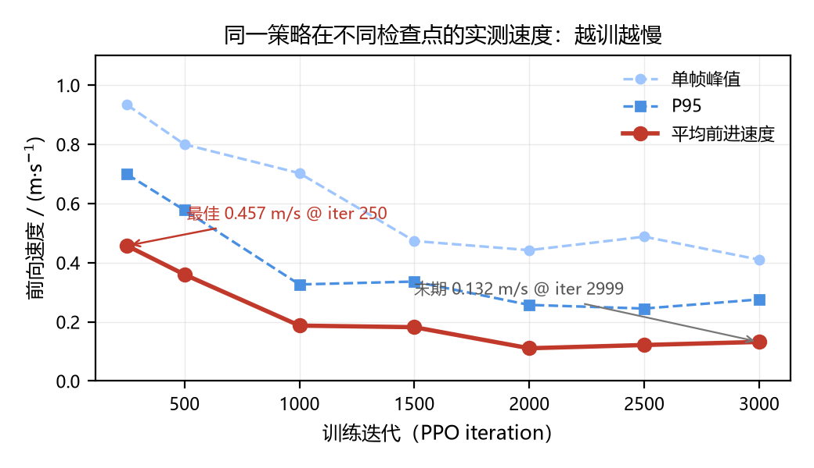

# MicroDuck Sprint · 双足机器鸭短跑策略

**用 MuJoCo Warp + PPO，在一台 DGX Spark 上把 800 g 的机器鸭练成短跑选手。**

[]() []() []() []()

---

## 0. 一句话结论

> 出厂配置的 MicroDuck 只能走 **±0.4 m/s**；本仓库把它推到 **0.457 m/s 平均 / 0.934 m/s 单帧峰值**（同口径、命令 1.6 m/s，提升 **3.09 倍**），
> 并在训练到 3000 轮时观察到**性能单调退化到 0.132 m/s**——**训练更久不等于跑得更快**，这是本仓最值得看的一条负结果。
>
> 社区公开成绩 **2.07 m/s**（4090D + 512 环境 + 13500 轮）**没有复现**。本仓库不做跨口径比较，所有结论只在本仓测速协议内成立。

---

## 1. 这是什么

MicroDuck 是 Pollen Robotics 开源的 ~25 cm / ~800 g 双足机器人，14 个舵机关节（+ 1 个下颚联动），RK3566 主控、BMI088 IMU、CSI 摄像头、2S 锂电。官方 `microduck_rl` 提供基于 [mjlab](https://github.com/mujocolab/mjlab)（MuJoCo Warp 后端）+ `rsl_rl` 的 PPO 训练栈，出厂任务是**速度跟随（走路）**，命令上限 ±0.4 m/s。

本项目做的事：

| 项 | 内容 |
|---|---|
| 任务 | 自定义 `Mjlab-Sprint-Flat-MicroDuck` / `Mjlab-SprintV2-Flat-MicroDuck` |
| 目标 | 直线冲刺，越快越好；鼓励双脚腾空，惩罚滑步与动作变形 |
| 方法 | PPO（rsl_rl），4096 并行环境，MuJoCo Warp（`newton_mjwarp` 物理后端） |
| 算力 | DGX Spark（GB10，121 GB 统一内存，aarch64），单卡 |
| 产物 | 2 版奖励配方、3000 轮训练曲线、7 个检查点测速、144 段训练录像、1 篇双栏论文稿 |

**这不是官方项目**，是 `microduck_rl` 的派生配置 + 独立评测脚本。原始代码版权归 Pollen Robotics（Apache-2.0），本仓只放自己的改动与结果。

### 仓库包含两部分，请分开看

| 部分 | 目录 | 性质 | 是否训练 |
|---|---|---|---|
| **① 短跑策略**（本仓主体） | `src/`、`data/`、`figs/`、`videos/sprint_progression.mp4` 等 | 本项目自行设计奖励并用 PPO 训练 | ✅ 从预训练 checkpoint 续训 3000 轮 |
| **② 课程复现**（8 本 Notebook） | [`course/`](course/) | 跟 Datawhale MicroDuck 专题，用官方预训练模型 | ❌ 不训练、不连板 |

两部分共用同一只鸭子，但**不是同一个实验**：① 的指标是本仓测速协议下自己训出来的；② 只做模型加载与闭环复现。把两者的数字混着比会得出错误结论。

课程部分（篮球平衡、浏览器扰动、高跷、摆动、球平衡、爬梯、RDK 板端、LightNav 视觉语言导航）的心得与实测记录见 **[course/Task1-8_学习心得全集.md](course/Task1-8_学习心得全集.md)**。

> 同一批课程内容在 Gitee 与 GitHub 上的目录结构不一致：GitHub `main` 只有 Task1/Task2，Task3–8 打包在 `microduck-task2` 分支的 `task3/notebooks/` 下。三处位置的对照表见 **[course/README.md](course/README.md)** 第四节之二。

**Task8 已做一轮控制层优化**（不训练、不改权重）：三场景平均残余距离从 1.477 m 压到 1.127 m，改善 21.7%，但仍未全部到达。完整诊断与 18 组实验数据见 **[course/optimization/README.md](course/optimization/README.md)**。

---

## 2. 核心结果

### 2.1 同口径测速（32 环境 × 1200 步，命令锁 1.6 m/s，丢前 100 步暖机）

| 配方 | 检查点 | 命令 (m/s) | 平均 | 中位 | P95 | 单帧峰值 |
|---|---|---:|---:|---:|---:|---:|
| 官方出厂（**仅命令上限，未实测**） | — | 0.4 | — | — | — | — |
| Sprint **v1**（奖励失衡） | `model_250` | 1.6 | 0.1481 | 0.1539 | 0.2058 | 0.2507 |
| Sprint **v2**（本文配方） | `model_250` | 1.6 | **0.4572** | **0.4560** | **0.6988** | **0.9335** |
| Sprint v2 | `model_250` | 2.6 | 0.1797 | 0.1780 | 0.3264 | 0.5457 |
| Sprint v2 | `model_2999` | 1.6 | 0.1321 | 0.1215 | 0.2756 | 0.4103 |
| Sprint v1 | `model_750` | 2.6 | 0.0905 | 0.0906 | 0.1646 | 0.2804 |

**v2 / v1 = 3.09 倍**（0.1481 → 0.4572）。全部数值可在 `data/*.json` 复核，字段含 `forward_speed_{mean,median,p95,peak_frame,peak_env}_mps`。

### 2.2 训练越久越慢（本仓最重要的负结果）

同一配方 v2，只换检查点、其余测速条件完全相同：

| 训练轮次 | 250 | 500 | 1000 | 1500 | 2000 | 2500 | 2999 |
|---|---:|---:|---:|---:|---:|---:|---:|
| 平均前进速度 (m/s) | **0.4572** | 0.3599 | 0.1872 | 0.1818 | 0.1106 | 0.1216 | 0.1321 |
| 相对最佳 | 100% | 78.7% | 41.0% | 39.8% | 24.2% | 26.6% | 28.9% |



训练侧的同步证据：偏航跟踪误差 `error_vel_yaw` 从 0.053 涨到 **0.712**（13 倍），腾空时间 `air_time_mean` 从 0.050 涨到 0.087 s。
**策略在后期学会的是「原地小幅扭动 + 高频腾空」，不是跑得更快**——奖励里的 `air_time` 项即使在 v2 降权到 1.0、门槛抬到 0.5 m/s 之后，仍然是一条可被利用的捷径。

### 2.3 训练过程指标（v2，3000 轮）

| 指标 | 初值 | 末值 | 说明 |
|---|---:|---:|---|
| `track_lin_vel` 奖励 | 0.018 | **2.13** | 速度追踪奖励提升 118 倍，训练目标确实在收敛 |
| `mean_reward` | −1.05 | 16.80 | 回合累计奖励 |
| `mean_episode_length` | 24 步 | 290 步 | 回合长度 12 s（600 控制步）下的实际存活 |
| `error_vel_xy` | 0.026 | 0.088 | 线速度跟踪误差反而变大 |
| `error_vel_yaw` | 0.053 | **0.712** | 偏航失控，退化主因 |
| `air_time_mean` | 0.050 | 0.087 | 腾空时间变长（但与速度脱钩） |
| `slip_velocity_mean` | 0.092 | 0.054 | 滑步下降，说明「假速度」不是主因 |

> 结论：**回合奖励（16.8）与实测速度（0.13 m/s）严重脱钩**。任何用 `mean_reward` 当性能指标的做法在这类任务上都会误判。

---

## 3. 关键发现

**① 奖励权重决定「意愿」，命令覆盖决定「上限」。**
v1 的 `air_time` 权重 5.0 而 `track_linear_velocity` 只有 3.0 → 策略站着踮脚刷腾空分，实测 0.09 m/s 还越训越慢。v2 把速度权重提到 6.0、腾空降到 1.0 并抬门槛到 0.5 m/s，同轮次速度直接 ×3.09。
但把命令从 1.6 拉到 2.6（超出 v2 的课程上限 1.6）时，速度**回落到 0.18**——超出训练分布的命令不会被"更努力"满足，只会让策略失稳。

**② 300 轮以内就到顶，之后是退化而不是收敛。**
最佳检查点在 **iter 250**（约 40 分钟训练）。继续训到 2999 轮，速度掉到 0.132。若按「30% 提升」调参、不做事中评测，会把最好的一版训没。

**③ 单帧峰值 ≠ 平均速度。**
`peak_frame` 0.9335 与 `mean` 0.4572 差 2 倍，`peak_env`（单环境最优）能到 1.82 m/s。公开成绩里的「峰值 2.07、瞬时 2.20」属于**瞬时读数**口径，与平均速度不可直接比。本仓同时给出四个统计量，避免口径歧义。

**④ 在 aarch64 的 GB10 上，MuJoCo Warp 的瓶颈不是算力而是显存带宽与 kernel 启动开销。**
4096 环境 × 24 子步 ≈ 9.1 s/iter（约 10.8 k 环境步/秒）；把环境数降到 512 时单轮并未显著变快，说明小规模下 Warp 的调度开销占比过高，**并行度必须堆到 4096 才划算**。

---

## 4. 可视化

| 内容 | 文件 | 说明 |
|---|---|---|
| **训练进度合辑（60 s）** | [`videos/sprint_progression.mp4`](videos/sprint_progression.mp4) | iter 0 → 71500 env-step 的 10 个时间点剪在一起，左上角标注轮次 |
| 关键片段（10 段） | [`videos/clips/`](videos/clips/) | 逐段原始录像，30 fps，640×360 |
| 全部 144 段（v2） | [`videos/train_clips_full.zip`](videos/train_clips_full.zip) | 26 MB，每 500 轮一段，完整训练轨迹 |
| v1 失败实验（13 段） | [`videos/v1_clips.zip`](videos/v1_clips.zip) | 2.7 MB，站着刷腾空分的现场证据 |
| 训练曲线（v1 失败归因） | `figs/fig2_v1_training.png`、`figs/fig3_reward_imbalance.png` | 回合奖励涨、速度跌，奖励构成倒挂 |
| 配方对照 | `figs/fig4_speed_compare.png`、`figs/fig6_v1_v2_curves.png` | v1 vs v2 同口径 |
| 检查点退化曲线 | `figs/fig7_checkpoint_decay.png` | 本文 2.2 节 |

> Gitee / GitHub 的 Markdown 不支持内嵌 mp4，点击文件名下载后播放。

**在线可视化站**：DGX 局域网常驻站点（站点第八章之后的「鸭子短跑」章节，端口 8000），仅在实验室内网可达。

> 课程 8 本的 17 段实拍视频（篮球、高跷、摆动、球平衡、爬梯、RDK 闭环、LightNav 三场景、跨缝跳跃）与 15 份验收 JSON 单独放在 [`course/`](course/)，见 [course/README.md](course/README.md)。

---

## 5. 硬件清单与 BOM

完整表见 **[`docs/HARDWARE_BOM.md`](docs/HARDWARE_BOM.md)**，此处给摘要。

**训练侧（本次实际使用）**

| 部件 | 型号 | 关键参数 |
|---|---|---|
| 算力节点 | NVIDIA DGX Spark（GB10） | 20× Cortex-X925（aarch64）、121 GB 统一内存、1× GB10 GPU、CUDA 13.0、驱动 580.159 |
| 系统 | Ubuntu 24.04.4 LTS（kernel 6.17.0-1021-nvidia） | — |
| 存储 | 3.7 TB NVMe | `/` 使用 71% |
| 软件栈 | Python 3.12 / torch 2.11.0+cu130 / MuJoCo 3.10.0 / mjlab / rsl_rl / uv | — |

**机器人本体（依据官方公开参数，非采购清单）**

| 项 | 参数 |
|---|---|
| 尺寸 / 质量 | ~25 cm 高 / ~800 g（MJCF 骨架合计 0.737 kg） |
| 自由度 | 14 主动关节：`left/right_{hip_yaw,hip_roll,hip_pitch,knee,ankle}` + `neck_pitch` + `head_{pitch,yaw,roll}`；另 1 个下颚联动 |
| 主控 | Rockchip RK3566（Linux，50 Hz 控制环） |
| 传感 | BMI088 IMU、CSI 摄像头（IMX219 类） |
| 供电 | 2S 锂电，标称 7.4 V，满电 8.2 V，欠压保护 6.0–6.6 V |

---

## 6. 仓库结构

```
duckf--the-playful-duck/
├── README.md                     ← 本文件
├── docs/
│   ├── HARDWARE_BOM.md           硬件清单 + BOM 表
│   ├── TRAINING_LOG.md           从 0 到 1 的完整实验日志（含失败）
│   ├── METRICS_PROTOCOL.md        测速协议（四统计量、暖机、环境数）
│   ├── experiment_log.md         原始实验台账（历史版本）
│   └── style_guide.md            论文写作口径（证据分级、退稿点）
├── src/
│   ├── microduck_sprint_env_cfg.py   冲刺环境配置（v1 / v2 两个 preset）
│   ├── tasks_init_patch.md           任务注册补丁说明
│   └── upstream_snapshot/            上游源码快照（无网格资源，1.2 MB，便于对照）
├── scripts/
│   ├── probe_sprint_speed.py     测速：加载 ckpt → 32 环境跑 1200 步
│   ├── export_sprint_metrics.py  TensorBoard → JSON
│   ├── make_figs.py              数据 → 图
│   ├── build_paper.py            数据 + 图 → 双栏 docx
│   ├── duck_queue.sh             对照实验队列（夜间无人值守）
│   └── setup_duckrl.sh           一键复现环境（拉上游 + 打补丁）
├── data/                         9 份 JSON：训练曲线、各检查点测速
├── checkpoints/                  model_250.pt（最佳）、model_2999.pt（末期）
├── figs/                         6 张图
├── videos/                       合辑 + 10 段片段 + 144 段全量 zip
├── course/                       课程 8 本复现（与短跑策略相互独立）
│   ├── Task1-8_学习心得全集.md    8 本逐本心得 + 六条总结
│   ├── validation/               15 份验收 JSON（原始执行记录）
│   └── videos/                   17 段课程实拍 MP4
└── papers/                       双栏投稿稿 docx
```

---

## 7. 快速开始

```bash
# 1) 环境（需 aarch64 + CUDA，x86 亦可但未验证）
git clone https://github.com/pollen-robotics/microduck_rl.git duck-rl
cd duck-rl && uv sync

# 2) 接入本仓配方
cp ../src/microduck_sprint_env_cfg.py src/mjlab_microduck/tasks/
cat ../src/tasks_init_patch.md >> src/mjlab_microduck/tasks/__init__.py

# 3) 训练（v2 配方，4096 环境）
MUJOCO_GL=egl WANDB_MODE=disabled .venv/bin/train Mjlab-SprintV2-Flat-MicroDuck \
  --env.scene.num-envs 4096 --agent.max-iterations 3000 \
  --agent.run-name duck_sprint_v2 --agent.logger tensorboard \
  --agent.save-interval 250 --video True --video-length 300 --video-interval 250

# 4) 测速（本仓协议）
.venv/bin/python scripts/probe_sprint_speed.py \
  --ckpt logs/rsl_rl/velocity/<run>/model_250.pt \
  --task Mjlab-SprintV2-Flat-MicroDuck --cmd 1.6 --steps 1200 --num-envs 32 \
  -o logs/speed.json
```

**坑（都踩过）**

| 现象 | 原因 | 解法 |
|---|---|---|
| `torch.cuda.is_available() == False` | `uv sync` 装的是 CPU 轮子 | 从 CUDA 环境复制 torch，或 `uv pip install --index-url https://download.pytorch.org/whl/cu130 torch` |
| 视频时长读成 0 | clip 流式写入无 mvhd | 先 remux，或 `nb_frames / fps` 回退 |
| `--headless` 无法识别 | mjlab 无此参数 | 直接不加 |
| 训练无图像 | 缺 MoviePy | `pip install "moviepy>=1.0.3,<2.0"` |

---

## 8. 两版奖励配方（核心差异）

| 奖励项 | 官方出厂 `Mjlab-Velocity-Flat-MicroDuck` | v1 | v2 |
|---|---:|---:|---:|
| `track_linear_velocity` | 2.0 | 3.0 | **6.0** |
| `track_angular_velocity` | 2.0 | 1.0 | 1.0 |
| `air_time` | 3.0 | **5.0** | **1.0** |
| `air_time.command_threshold` | 0.01 | 0.05 | **0.5** |
| `air_time` 窗 `[min, max]` | [0.125, 0.300] | [0.10, 0.35] | [0.12, 0.30] |
| `upright` | 2.0 | 1.0 | 0.5 |
| `pose` | 1.0 | 0.3 | 0.1 |
| `head_pose_tracking` | 2.0 | 0.3 | 0.1 |
| `body_pose_tracking` | 0.0 | 0.0 | 0.0 |
| `foot_slip` | −0.1 | −0.35 | −0.35 |
| `foot_clearance` | −2.0 | −1.0 | −1.0 |
| `foot_swing_height` | −0.25 | −0.25 | −0.25 |
| `action_rate_l2` | −0.1 | −0.05 | −0.05 |
| `body_ang_vel` | −0.05 | −0.03 | −0.03 |
| 命令区间 `lin_vel_x` | (−0.4, 0.4) | (0.8, 2.6) | **(0.3, 1.6)** |
| 命令区间 `lin_vel_y` | (−0.3, 0.3) | (−0.12, 0.12) | (−0.12, 0.12) |
| 命令区间 `ang_vel_z` | (−1.0, 1.0) | (−0.25, 0.25) | (−0.25, 0.25) |
| 回合长度 | 20 s | 12 s | 12 s |

v1 的失败是**结构性的**：速度奖励 3.0 + 腾空 5.0，等于告诉策略「跳比跑值钱」。实测 v1 回合奖励 49.4、回合顶满 600 步、摔倒率 0.2%，但速度 0.09 m/s —— **站着不动也能刷满分**。

---

## 9. 数据字典

| 文件 | 内容 |
|---|---|
| `data/v2_metrics_full.json` | v2 全 3000 轮、46 个标量的完整曲线（261 KB） |
| `data/v1_metrics.json` | v1 前 888 轮（被人工终止） |
| `data/v1_speed_cmd16.json` | v1 `model_250` @ 1.6 m/s |
| `data/v2_speed.json` | v2 `model_250` @ 1.6 m/s（**主结果**） |
| `data/v2_speed_cmd26.json` | v2 `model_250` @ 2.6 m/s（超分布命令） |
| `data/v2_speed_final_c16.json` | v2 `model_2999` @ 1.6 m/s（退化证据） |
| `data/sweep_*.json` | 各检查点同口径测速（退化曲线原始数据） |

测速字段定义见 [`docs/METRICS_PROTOCOL.md`](docs/METRICS_PROTOCOL.md)。

---

## 10. 边界：本仓没做到什么

1. **没复现 2.07 m/s。** 最佳 0.457 m/s 平均，与公开成绩差 4.5 倍。差距来源未定量拆解（环境数 512 vs 4096、迭代 13500 vs 250、奖励设计差异），本仓不做归因，只报事实。
2. **没做真机迁移。** 全部结果来自仿真（MuJoCo Warp）。MJCF 已含 2° 反向间隙与电压跌落随机化，但 sim2real 未验证。
3. **2999 轮的检查点已退化，不建议用。** 保留它是为了留证据，不是为了部署。
4. **论文稿未经同行评审**，`papers/` 里是投稿版本，数字与本文一致但结论表述更保守。

---

## 11. 引用与许可

- 上游：Pollen Robotics [`microduck`](https://github.com/pollen-robotics/microduck) / [`microduck_rl`](https://github.com/pollen-robotics/microduck_rl)（Apache-2.0）
- 仿真：mjlab（MuJoCo Warp 后端），MuJoCo 3.10.0
- 算法：rsl_rl（PPO）
- 本仓改动与数据：Apache-2.0，见 `LICENSE`

```bibtex
@misc{microduck_sprint_2026,
  title  = {MicroDuck Sprint: Reward-Structure Tuning and Evaluation Protocol for
            Bipedal Sprinting Policies in MuJoCo Warp},
  author = {Li, Zipeng},
  year   = {2026},
  note   = {DGX Spark (GB10), mjlab + rsl_rl PPO, 3000 iterations}
}
```

---

*所有数字由 `scripts/` 下的脚本从原始日志生成，无需手抄。改配方 → 重跑 → 数字自动更新。*
